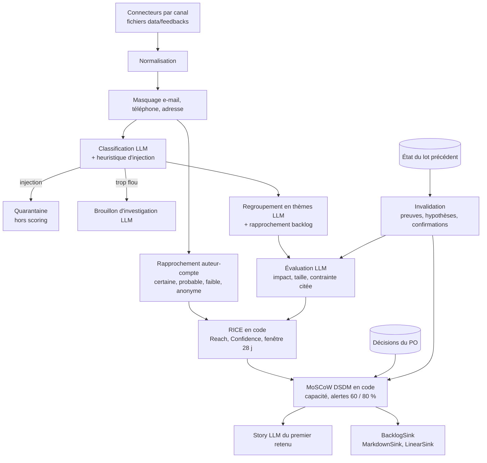

# Agent IA pour Product Owner

Assistant d'un Product Owner de startup SaaS de gestion de projet : analyser les feedbacks clients, éclairer la priorisation du backlog et rédiger les user stories.

Présentation : [lien Google Slides à venir]

## Problème et persona

Nadia Ferri est Product Owner d'**Étai**, un SaaS de pilotage de chantier pour les PME du bâtiment. Les feedbacks arrivent par e-mail, ticket, avis G2 et Capterra, forum, Reddit et X. Elle repriorise le backlog chaque semaine. Son équipe produit tient déjà ce backlog dans Linear.

Le cas fictif, les OKR et la capacité du cycle sont dans [`data/context/strategy.md`](data/context/strategy.md).

## Démarrage

Node 22 et pnpm 10.

```bash
pnpm install
pnpm agent run --batch lundi
pnpm agent run --batch jeudi
```

Aucune clé n'est nécessaire : par défaut, l'agent rejoue des réponses LLM déjà écrites (`fixtures/llm/`), sans réseau. Ces réponses ont été **rédigées à la main**, pas produites par un modèle : le mode rejoué démontre le pipeline, pas la qualité d'un LLM.

Pour un vrai modèle, voir [Passage réel sur OpenRouter](#passage-réel-sur-openrouter).

Ce que produit chaque lot, dans `out/` (ignoré par git) :

| Fichier | Contenu |
| --- | --- |
| `out/<lot>/brief.md` | Brief de la semaine : à décider, tendances, quarantaine, churn, cas flous |
| `out/<lot>/priorisation.md` | Tableau RICE et MoSCoW, alertes de capacité, détail du Reach |
| `out/<lot>/story-<thème>.md` | User story du premier élément retenu (Given/When/Then, taille, INVEST, questions) |
| `out/lundi/investigation-fb-lundi-12.md` | Questions et brouillon de réponse pour le cas flou, non envoyé |
| `out/jeudi/changements.md` | Ce qui a bougé depuis lundi, et pourquoi |
| `out/backlog/` | Export local idempotent (`MarkdownSink`), une entrée par clé stable |
| `out/state/<lot>.json` | État repris par le lot suivant, sans texte brut ni e-mail |

Le lot jeudi reprend l'état de lundi (et lance lundi d'abord s'il n'existe pas). Les décisions du PO (contraintes confirmées, surcharges d'impact ou de taille, libération de quarantaine) sont dans [`data/po-decisions.json`](data/po-decisions.json).

Options : `--reach comptes|volume|arr`, `--decisions <fichier>`, `--out <dossier>`, `--allow-stale-fixtures`. Aide : `pnpm agent --help`.

## Interface

```bash
pnpm dev   # http://localhost:43217
```

L'interface (Next.js, shadcn/ui, thème sombre) s'ouvre sur le brief du lundi. Le sélecteur **Lundi / Jeudi** garde l'écran courant ; jeudi affiche ce qui a changé depuis lundi.

| Écran | Contenu |
| --- | --- |
| Brief de la semaine | thèmes et tendances, alertes de capacité, signaux de churn, bugs critiques routés, quarantaine avec la raison, changements depuis lundi |
| Priorisation | tableau RICE et MoSCoW ; une ligne dépliée montre le calcul (comptes du Reach, règle de Confidence, table des tailles). Le PO modifie l'effort ou force une catégorie avec un motif : recalcul immédiat, arbitrages gardés dans le navigateur |
| Thèmes et stories | feedbacks sources avec citations vérifiées surlignées, user story, critères, complexité relative, bouton « Valider et exporter vers Linear », bloqué si le thème est « à revoir » |
| Recontact | brouillons modifiables (questions d'investigation, demande d'identifiant de compte). « Envoyer » dépose le message dans `out/outbox/` : rien n'est jamais envoyé |

**Mode démo (par défaut, sans `SUPABASE_URL`).** L'interface rejoue lundi puis jeudi depuis `fixtures/llm/`, avec le même pipeline que la CLI : aucun appel LLM, aucun réseau. Le badge **Données : démo** l'indique, ainsi qu'un bandeau. Les arbitrages du PO restent dans le navigateur. Le bouton d'export écrit en Markdown dans `out/linear-export/` tant que Linear n'est pas branché (badge **Export** à côté).

**Mode direct.** Avec `SUPABASE_URL` et `SUPABASE_KEY`, et après `pnpm db:seed`, le badge passe à **Données : Supabase**. Les feedbacks bruts, l'analyse et les arbitrages sont lus et écrits dans Postgres. L'écran Feedbacks permet de coller un e-mail, un ticket ou un commentaire : OpenRouter classe ce seul texte, le rattache à un thème existant ou en ouvre un, puis le RICE et le MoSCoW sont recalculés. Le temps passé est affiché pendant l'attente et à la fin. Si la base est absente, vide ou injoignable, l'interface revient au mode démo et le dit. Sans `OPENROUTER_API_KEY`, l'ajout est refusé et rien n'est enregistré.

**Mode Linear.** Avec `LINEAR_API_KEY` et `LINEAR_TEAM_ID` dans l'environnement ou dans `.env`, le même bouton crée ou met à jour l'issue Linear, en tenant compte des arbitrages faits dans l'écran Priorisation. Redémarrer `pnpm dev` suffit, sans rebuild.

## Déployer sur Render

`render.yaml` décrit le service web : build `pnpm build`, démarrage `next start` sur le port fourni par Render, contrôle de santé sur `/lundi`, redéploiement à chaque commit sur `main`. Dans Render : *New → Blueprint*, puis choisir ce dépôt. `LINEAR_API_KEY` et `LINEAR_TEAM_ID` sont demandées à la création ; vides, l'instance reste en mode démo. Les liens vers les feedbacks utilisent l'URL publique du service (`RENDER_EXTERNAL_URL`), sauf si `ETAI_PUBLIC_URL` est défini.

Sur l'offre gratuite, le service s'endort après une période sans visite : le premier affichage prend alors quelques dizaines de secondes. Le dossier `out/` n'y est pas conservé entre deux déploiements. Les feedbacks et les arbitrages, eux, restent dans Supabase une fois la base branchée.

## Brancher Supabase

Le projet Postgres est déjà créé. La migration n'est pas appliquée par le code : il faut la lancer soi-même (SQL Editor du dashboard, ou `supabase db query` une fois le CLI lié).

1. Ouvrir `supabase/migrations/20261109154558_persist_po_cycle.sql` et l'exécuter sur la base.
2. Copier `.env.example` vers `.env`. Renseigner `SUPABASE_URL` et `SUPABASE_KEY` (clé **publishable**, `sb_publishable_…`, jamais la clé secrète). Ces variables restent côté serveur : ne pas les préfixer par `NEXT_PUBLIC_`.
3. Charger le corpus de démo, sans appel de modèle :

```bash
pnpm db:seed
```

La commande rejoue lundi et jeudi depuis les fixtures, écrit les feedbacks bruts, les analyses et les arbitrages de départ. La relancer remet ce corpus et retire les feedbacks ajoutés dans l'interface.

4. Pour analyser un feedback collé dans l'interface, ajouter aussi `OPENROUTER_API_KEY`. Le profil utilisé est A (`ETAI_LLM_PROFILE` pour un autre). Chaque ajout est plafonné à 1 $ (`ETAI_LLM_BUDGET_USD`).

Sur Render, les mêmes variables se déclarent dans le blueprint : `SUPABASE_URL`, `SUPABASE_KEY`, `OPENROUTER_API_KEY`. Elles sont vides tant qu'on ne les remplit pas, et l'instance reste en mode démo. Le seed se lance en local, pas au démarrage du service.

Le rôle `anon` (celui de la clé publishable) peut lire et écrire les trois tables. C'est un compromis de démo : pas d'auth, pas de séparation entre PO. La marche à suivre pour la production est dans l'ADR-016.

## Brancher Linear

1. Clé : dans Linear, *Settings → Account → Security & access → Personal API keys → New API key*. Elle doit pouvoir écrire dans l'équipe.
2. Équipe : `LINEAR_TEAM_ID` accepte l'UUID de l'équipe ou sa clé, celle qui préfixe les identifiants d'issues (`THI` pour `THI-12`).
3. Mettre les deux dans `.env` (voir `.env.example`), jamais commité, ou les passer dans l'environnement.

```bash
pnpm export:linear --batch lundi --dry-run   # lit Linear, affiche ce qui serait créé ou mis à jour, n'écrit rien
pnpm export:linear --batch lundi             # export réel
pnpm export:linear --batch jeudi --theme partage_client --dry-run
```

L'export à blanc vérifie l'équipe, cherche chaque issue (LIN-xx rattachée, puis clé stable), les labels et les clients, puis liste les écritures qu'il aurait faites. Sans `LINEAR_API_KEY`, il simule hors ligne. L'export réel exige les deux variables.

Ce qui est écrit, pour chaque thème Must, Should ou Could non bloqué :

- une issue : titre, description (problème, score détaillé, citations, story et critères s'il y en a, liens vers les feedbacks), estimation dérivée de la taille (XS 1, S 2, M 4, L 6, XL 10), label `MoSCoW : <classe>` et label de catégorie (`Bug`, `Improvement` ou `Feature`, les labels par défaut de Linear, réutilisés s'ils existent) ;
- si le thème est rattaché à une issue du backlog qui existe dans l'équipe, cette issue est mise à jour au lieu d'en créer une autre. Seule la section Étai de la description change (entre deux marqueurs) ; le texte écrit à la main et l'estimation de l'équipe restent ;
- une demande client (Customer Request) par compte qui porte le thème, avec ses citations. Si la fonction Customers n'est pas activée dans l'espace, l'issue est exportée quand même et une note le signale. `LINEAR_CUSTOMER_REQUESTS=0` les désactive.

Relancer l'export ne crée pas de doublon. La CLI exporte le classement de l'agent et `data/po-decisions.json`. Les arbitrages faits dans l'interface partent avec le bouton : en mode démo ils vivent dans le navigateur, en mode direct ils sont relus depuis Supabase. Les liens vers les feedbacks pointent sur `http://localhost:43217` ; `ETAI_PUBLIC_URL` les redirige vers une instance publiée.

## Tests et évaluation

```bash
pnpm test        # tests unitaires et pipeline rejoué de bout en bout
pnpm eval        # comparaison à data/answer-key.json, rapport dans out/eval/rapport.md
pnpm eval:compare  # même évaluation avec de vrais modèles, voir plus bas
pnpm typecheck
pnpm lint
```

`pnpm eval` en mode rejoué évalue lundi et jeudi contre la clé, et le holdout sur les seules couches déterministes (rapprochement, heuristique d'injection). Les fixtures ayant été écrites après lecture de la clé, les scores de type et de thème en mode rejoué ne mesurent pas un modèle. `pnpm eval --provider real` classe aussi le holdout avec le vrai modèle.

## Passage réel sur OpenRouter

Prérequis : Node 22 (au minimum 20.12, pour `process.loadEnvFile`), pnpm 10.33 (`corepack enable` suffit), une clé OpenRouter.

```bash
pnpm install
OPENROUTER_API_KEY=sk-or-... pnpm eval:compare
```

La commande évalue trois profils sur lundi, jeudi et holdout, avec un plafond de 5 $ tous profils confondus, et écrit `out/eval-real/<profil>.json` et `out/eval-real/summary.md`. La clé peut aussi être mise dans `.env` (voir `.env.example`), jamais commitée.

| Profil | Étapes de texte | Décisions (type, injection, gravité, backlog) |
| --- | --- | --- |
| A | `anthropic/claude-sonnet-5.5` | dans la réponse de classification et de regroupement |
| B | `anthropic/claude-sonnet-5.5` | Jev (`typesafe/jev-1.14`, API Decisions), repli sur Sonnet 5.5 |
| C | `openai/gpt-5.6-luna` | dans la réponse de classification et de regroupement |

Options :

- `--profiles A,B` : sous-ensemble de profils, ou chemin vers un `.json` au même format que `config/llm-profiles/`.
- `--budget 5` : plafond en dollars. L'exécution s'arrête proprement quand il est atteint ; les profils restants sont marqués « non lancé » et le récapitulatif est écrit quand même.
- `--story-model anthropic/claude-opus-5.5` : modèle de la story pour tous les profils.
- `--record-fixtures A` : une fois le profil A terminé, remplace `fixtures/llm/` par ses sorties réelles de lundi et jeudi (jamais le holdout), avec un `manifest.json`. Les fichiers ne contiennent que les réponses : la commande refuse de les installer s'ils contiennent la clé ou un en-tête d'autorisation.

Mesures par profil : les métriques de `pnpm eval`, le nombre d'appels, le coût (`usage.cost`, sinon `GET /api/v1/generation`), la latence moyenne et p95 par appel, le taux de réponses hors schéma, les réponses de décision illisibles et les replis. Les réponses illisibles sont journalisées brutes dans `out/eval-real/raw-responses.jsonl`.

Un seul profil sur un seul lot : `pnpm agent run --batch lundi --provider real --profile B --budget 1`. Une éval d'un profil : `pnpm eval --provider real --profile A`.

Volume : contre le faux serveur des tests, un profil fait 79 appels de texte, sans compter les relances ; B y ajoute une requête de décision par feedback classé et une par thème nouveau. Le coût réel n'a pas été mesuré. Si le plafond par défaut ne suffit pas aux trois profils, relancer avec `--budget` plus élevé ou `--profiles` réduit.

## Pipeline



Les cases « LLM » passent par une interface `LlmProvider` sans aucun outil : le modèle ne peut que renvoyer un objet validé par Zod. Tout ce qui décide (Reach, Confidence, RICE, MoSCoW, tendance, citations exactes, invalidation) est du code testé.

## Démarche et choix techniques

L'énoncé reformulé est dans [`docs/brief.md`](docs/brief.md). Le journal de décisions est dans [`docs/decisions.md`](docs/decisions.md) : ADR-002 à 007 pour l'architecture, ADR-008 à 013 pour les choix de la phase 1 (seuils, allocation, sécurité, fixtures, invalidation), ADR-014 pour le passage réel sur OpenRouter, ADR-015 pour l'interface et l'export Linear, ADR-016 pour Supabase.

## Ce qui a été délégué à l'IA vs vérifié manuellement

Le journal est [`AI_USAGE.md`](AI_USAGE.md). Le code et les fixtures des phases 1 et 2 ont été écrits par Claude Opus 5.5. Les seuils et la règle d'allocation restent à valider par Valentin. L'ADR-016 décrit la persistance Supabase.

## Limites et prochaines étapes

- `LinearSink` est testé contre un faux Linear en mémoire, jamais contre l'API réelle. Premier essai prévu sur l'équipe THI, en commençant par `--dry-run`.
- Les identifiants LIN-xx du jeu de données sont fictifs : dans un vrai espace, ils sont introuvables et l'issue est créée (une note le dit).
- Sans `SUPABASE_URL`, ou si la base ne répond pas, l'interface reste en mode démo : fixtures, aucun modèle. Le badge et le bandeau le disent.
- En mode direct, les arbitrages de l'interface (effort, MoSCoW forcé) sont dans Supabase. En mode démo, ils restent dans le navigateur. Reconfirmer une contrainte « à revoir » se fait encore dans `data/po-decisions.json`, rechargé au seed.
- L'ajout d'un feedback dans l'interface exige `OPENROUTER_API_KEY`. Ce dépôt ne contient pas de résultat d'un tel appel : le flux est testé avec un faux client.
- Les fixtures sont rédigées, pas enregistrées. Elles sont à remplacer par `pnpm eval:compare --record-fixtures <profil>` dès qu'une clé est disponible.
- Le câblage OpenRouter est testé contre un faux serveur local, jamais contre l'API réelle : aucun résultat de modèle réel n'existe encore dans ce dépôt.
- Une fixture est liée à l'empreinte de ses données : modifier un feedback rend le mode rejoué strict en erreur, jusqu'à réenregistrement.
- Un feedback en quarantaine sort du scoring jusqu'à ce que le PO le libère. Conséquence visible dans l'éval : le thème « nom du PDF exporté » de la clé n'apparaît pas.
- Les connecteurs sont des fichiers. L'architecture de production est décrite (ADR-007), pas branchée.
- `data/feedbacks/holdout.json` ne sert pas à régler les seuils, et n'est pas accepté par `pnpm agent`.

## Arborescence

```
AI_USAGE.md                 journal d'usage des IA
docs/brief.md               énoncé reformulé
docs/decisions.md           ADR
data/context/               stratégie (md + json), comptes, backlog
data/feedbacks/             lots lundi, jeudi, holdout
data/answer-key.{md,json}   intention de conception
data/po-decisions.json      décisions du PO rejouées par la CLI
core/schemas/               schémas Zod
core/ingest, privacy, identity, security, evidence
core/scoring/               fenêtre, tendance, RICE, MoSCoW
core/llm/                   interface fournisseur, réel, rejoué, prompts, décisions
core/llm/openrouter/        client, chat, API Decisions (Jev), compteur de coût et budget
config/llm-profiles/        profils A, B, C : un modèle par étape
core/steps/                 classification, thèmes, évaluation, story, investigation
core/pipeline/              orchestration et état
core/report/, core/sink/    rendus markdown, BacklogSink (Markdown, Linear, export à blanc)
core/outbox/                brouillons de recontact, boîte de test
core/cli/, core/eval/       pnpm agent, pnpm export:linear, pnpm eval, pnpm eval:compare
fixtures/llm/               réponses rejouées
scripts/author-fixtures.ts  rédaction des fixtures (pnpm fixtures:author)
app/                        Next.js : écrans par lot, actions serveur (export, boîte de test, ajout, arbitrages)
components/etai/            composants des écrans ; components/ui/ : shadcn/ui
lib/etai/                   vues des lots, mode démo ou Supabase, arbitrages du PO, libellés
core/store/                 persistance (mémoire pour les tests, Supabase)
supabase/migrations/        schéma et politiques RLS, à appliquer sur la base
scripts/db-seed.ts          pnpm db:seed
.agents/skills/             skill emil-design-eng (animations, finitions)
```
