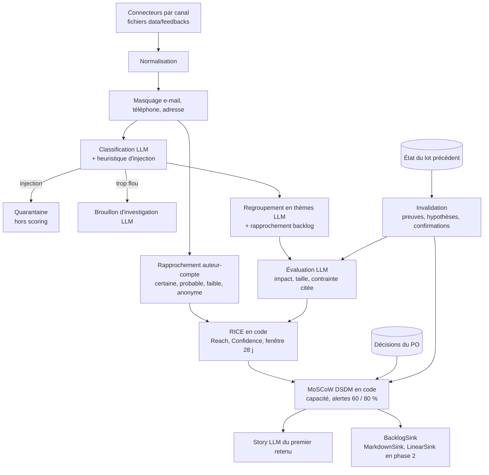

# Agent IA pour Product Owner

Assistant d'un Product Owner de startup SaaS de gestion de projet : analyser les feedbacks clients, éclairer la priorisation du backlog et rédiger les user stories.

Présentation : [lien Google Slides à venir]

## Problème et persona

Nadia Ferri est Product Owner d'**Étai**, un SaaS de pilotage de chantier pour les PME du bâtiment. Les feedbacks arrivent par e-mail, ticket, avis G2 et Capterra, forum, Reddit et X. Elle repriorise le backlog chaque semaine. Son équipe produit tient déjà ce backlog dans Linear.

Le cas fictif, les OKR et la capacité du cycle sont dans [`data/context/strategy.md`](data/context/strategy.md).

## Démarrage

Node 22 et pnpm 10.

```bash
pnpm install
pnpm agent run --batch lundi
pnpm agent run --batch jeudi
```

Aucune clé n'est nécessaire : par défaut, l'agent rejoue des réponses LLM déjà écrites (`fixtures/llm/`), sans réseau. Ces réponses ont été **rédigées à la main**, pas produites par un modèle : le mode rejoué démontre le pipeline, pas la qualité d'un LLM.

Pour un vrai modèle : copier `.env.example` vers `.env`, renseigner `LLM_PROVIDER`, `LLM_MODEL` et la clé, puis `pnpm agent run --batch lundi --provider real`. Ajouter `--record` pour remplacer les fixtures par des réponses enregistrées.

Ce que produit chaque lot, dans `out/` (ignoré par git) :

| Fichier | Contenu |
| --- | --- |
| `out/<lot>/brief.md` | Brief de la semaine : à décider, tendances, quarantaine, churn, cas flous |
| `out/<lot>/priorisation.md` | Tableau RICE et MoSCoW, alertes de capacité, détail du Reach |
| `out/<lot>/story-<thème>.md` | User story du premier élément retenu (Given/When/Then, taille, INVEST, questions) |
| `out/lundi/investigation-fb-lundi-12.md` | Questions et brouillon de réponse pour le cas flou, non envoyé |
| `out/jeudi/changements.md` | Ce qui a bougé depuis lundi, et pourquoi |
| `out/backlog/` | Export local idempotent (`MarkdownSink`), une entrée par clé stable |
| `out/state/<lot>.json` | État repris par le lot suivant, sans texte brut ni e-mail |

Le lot jeudi reprend l'état de lundi (et lance lundi d'abord s'il n'existe pas). Les décisions du PO (contraintes confirmées, surcharges d'impact ou de taille, libération de quarantaine) sont dans [`data/po-decisions.json`](data/po-decisions.json).

Options : `--reach comptes|volume|arr`, `--decisions <fichier>`, `--out <dossier>`, `--allow-stale-fixtures`. Aide : `pnpm agent --help`.

## Tests et évaluation

```bash
pnpm test        # tests unitaires et pipeline rejoué de bout en bout
pnpm eval        # comparaison à data/answer-key.json, rapport dans out/eval/rapport.md
pnpm typecheck
pnpm lint
```

`pnpm eval` en mode rejoué évalue lundi et jeudi contre la clé, et le holdout sur les seules couches déterministes (rapprochement, heuristique d'injection). Les fixtures ayant été écrites après lecture de la clé, les scores de type et de thème en mode rejoué ne mesurent pas un modèle. `pnpm eval --provider real` classe aussi le holdout avec le vrai modèle.

## Pipeline



Les cases « LLM » passent par une interface `LlmProvider` sans aucun outil : le modèle ne peut que renvoyer un objet validé par Zod. Tout ce qui décide (Reach, Confidence, RICE, MoSCoW, tendance, citations exactes, invalidation) est du code testé.

## Démarche et choix techniques

L'énoncé reformulé est dans [`docs/brief.md`](docs/brief.md). Le journal de décisions est dans [`docs/decisions.md`](docs/decisions.md) : ADR-002 à 007 pour l'architecture, ADR-008 à 013 pour les choix de la phase 1 (seuils, allocation, sécurité, fixtures, invalidation).

## Ce qui a été délégué à l'IA vs vérifié manuellement

Le journal est [`AI_USAGE.md`](AI_USAGE.md). Le code et les fixtures de la phase 1 ont été écrits par Claude Opus 5.5. Les seuils et la règle d'allocation restent à valider par Valentin.

## Limites et prochaines étapes

- Pas encore d'interface : `app/` est un placeholder (phase 2). `pnpm dev` le sert sur le port 43217.
- `LinearSink` est un bouchon documenté : aucune écriture externe en phase 1.
- Les fixtures sont rédigées, pas enregistrées. Elles sont à remplacer par `--provider real --record` dès qu'une clé est disponible.
- Une fixture est liée à l'empreinte de ses données : modifier un feedback rend le mode rejoué strict en erreur, jusqu'à réenregistrement.
- Un feedback en quarantaine sort du scoring jusqu'à ce que le PO le libère. Conséquence visible dans l'éval : le thème « nom du PDF exporté » de la clé n'apparaît pas.
- Les connecteurs sont des fichiers. L'architecture de production est décrite (ADR-007), pas branchée.
- `data/feedbacks/holdout.json` ne sert pas à régler les seuils, et n'est pas accepté par `pnpm agent`.

## Arborescence

```
AI_USAGE.md                 journal d'usage des IA
docs/brief.md               énoncé reformulé
docs/decisions.md           ADR
data/context/               stratégie (md + json), comptes, backlog
data/feedbacks/             lots lundi, jeudi, holdout
data/answer-key.{md,json}   intention de conception
data/po-decisions.json      décisions du PO rejouées par la CLI
core/schemas/               schémas Zod
core/ingest, privacy, identity, security, evidence
core/scoring/               fenêtre, tendance, RICE, MoSCoW
core/llm/                   interface fournisseur, réel, rejoué, prompts
core/steps/                 classification, thèmes, évaluation, story, investigation
core/pipeline/              orchestration et état
core/report/, core/sink/    rendus markdown, BacklogSink
core/cli/, core/eval/       pnpm agent, pnpm eval
fixtures/llm/               réponses rejouées
scripts/author-fixtures.ts  rédaction des fixtures (pnpm fixtures:author)
app/                        Next.js, placeholder de la phase 2
```
